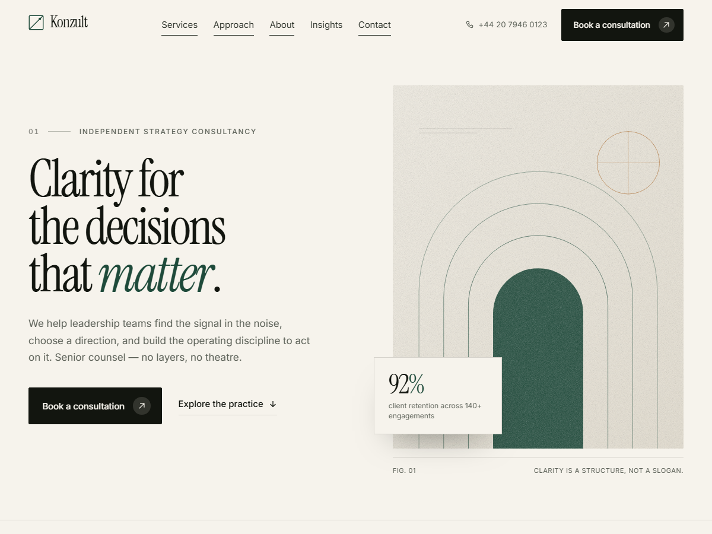

# Konzult

A sleek, editorial WordPress theme for consulting practices, advisory firms and strategy studios. Built to look finished on activation, to work with **free Elementor**, and to stay readable and fast.



- **Version:** 1.0.0
- **Requires:** WordPress 6.4+, PHP 8.0+
- **License:** [GPL-2.0-or-later](LICENSE)
- **Text domain:** `konzult`

---

## 1. Install

1. Copy the `konzult` folder into `wp-content/themes/`, or upload the ZIP in **Appearance → Themes → Add New → Upload Theme**.
2. Activate the theme.
3. Visit **Settings → Permalinks** and click *Save* once (refreshes rewrite rules and demo anchors).
4. The homepage is populated on activation — no demo import required.

## 2. First-run setup (10 minutes)

### Menus
**Appearance → Menus** → create a menu → assign it to **Primary menu**. Assign a second, shorter menu to **Footer menu** (optional).

If you skip this step, the theme falls back to your top-level pages, or to the homepage anchors.

### Logo
**Appearance → Customize → Site Identity** → upload a logo. Without one, the theme renders a typographic wordmark with the square mark.

### Header
**Appearance → Customize → Konzult options → Header**

| Setting | Purpose |
|---|---|
| Button label | Text in the header CTA |
| Button link | Use `#contact` to scroll to the closing section, or any URL |
| Phone number | Shown beside the button on screens wider than 1200px |

### Footer
**Konzult options → Footer** — short description, copyright, and LinkedIn / X / Instagram URLs.
Footer columns appear automatically if you add widgets to **Footer column 1–3**. Otherwise the theme's own three-column layout is used.

### Brand colour
**Konzult options → Brand colour** — one accent colour drives links, italics, hovers and small marks. The neutral palette is intentionally fixed so the design holds together.

## 3. Using Elementor (free)

The theme is built for Elementor free:

- Pages built with Elementor render inside the theme's header and footer.
- Elementor's **Canvas** and **Full Width** page templates are available for landing pages.
- The included starter template recreates the homepage design in Elementor so you can edit it visually.

### Import the homepage template

1. **Templates → Saved Templates → Import Templates**
2. Choose `elementor/templates/home.json`
3. Create a new page called *Home*, then **Edit with Elementor**
4. Click the folder icon → **My Templates** → insert **Konzult — Home**
5. Publish, then **Settings → Reading → Your homepage displays → A static page** and select *Home*

The template is typographic on purpose: it ships without stock photography, so nothing breaks on import and you can drop in your own imagery.

> **Elementor Pro:** if Pro is active, the theme registers all core Theme Builder locations. You can then build the header, footer, single post and archive templates in Elementor. On free Elementor those locations stay in PHP, which is why the theme's chrome is fully designed and configurable in the Customizer.

## 4. Editing the built-in homepage

The homepage is assembled from PHP sections in `template-parts/home/`:

```
hero.php      clients.php   intro.php    services.php
stats.php     process.php   quote.php    insights.php   cta.php
```

Each section is self-contained and uses `esc_html__()` for copy, so you can edit text directly or translate it. To remove a section, delete its `get_template_part()` line in `front-page.php`.

The **Insights** section only appears once you publish posts. The **stats** counters animate when scrolled into view.

To use the normal blog index as your homepage instead:
**Customize → Homepage settings →** uncheck the demo showcase (or set a static front page with your own content).

## 5. Design system

| Token | Value |
|---|---|
| Ink | `#12150F` |
| Paper | `#F6F3EC` |
| Paper deep | `#EDE8DC` |
| Pine (accent) | `#1E4A3A` |
| Sienna | `#B9814A` |
| Display type | Instrument Serif |
| UI / body type | Inter (variable) |

All tokens live at the top of `assets/css/main.css` as custom properties. Fonts are self-hosted in `assets/fonts/` (latin subset, woff2) — no Google Fonts request, no consent banner.

`theme.json` exposes the same palette and type scale to the block editor.

## 6. Motion

`assets/js/main.js` is dependency-free and does five things:

1. sticky header state
2. scroll reveals with `IntersectionObserver`
3. stat counters
4. the `<dialog>` mobile menu (native focus trap and Escape)
5. a 16px parallax on the hero artwork

Everything is disabled under `prefers-reduced-motion: reduce`, and content is visible if JavaScript fails.

